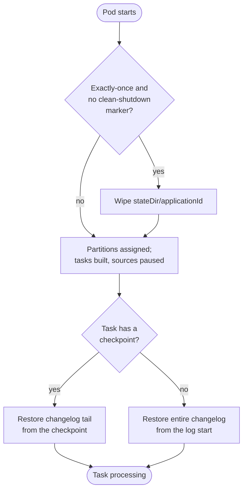

A `wireform-kafka-streams` process keeps its working state on local
disk. The RocksDB backend
(`Kafka.Streams.State.KeyValue.RocksDB`, built with the
`+rocksdb` Cabal flag) writes column-family files under
`<stateDir>/<applicationId>/<task>/`; the WAL-backed
`Kafka.Streams.State.KeyValue.Persistent` backend does the same.
Either way, "the database lives in the container" is the model.

Containers break four assumptions that model relies on.

First, the filesystem is expected to outlive the process. Second, the hostname should be stable across restarts. Third, memory consumption should be predictable. Fourth, there should be time to flush state on shutdown.

In containers, none of these hold by default.

This page covers how to put each one back.

:::tip[Unfamiliar terms?]
Kafka, Streams, and Riffle terminology is defined in the [Glossary](../glossary/).
:::

:::note[TL;DR]
- Mount a persistent volume at `stateDir` (default `/tmp/kafka-streams`) or pay the changelog-replay cost on every restart.
- One pod = one stable identity: `StatefulSet`-style ordinals + a stable `clientId` and a volume that follows the ordinal, so a restarted pod restores only the changelog tail after its checkpoints. There are no standby replicas: failover time is restore time.
- RocksDB block cache and write buffers are **off-heap**. The container memory limit must cover heap + RocksDB + page-cache headroom, or the OOM-killer takes you mid-compaction.
- Give `closeKafkaStreams` enough wall-clock time to reach its final commit (`terminationGracePeriodSeconds` above its 30 s `timeoutMs`).
- Without persistent volumes, every restart restores every store from its changelog; keep changelogs compacted and size rollouts around restore time.
:::

## 1. State persistence

A streams instance owns RocksDB directories under
`stateDir`. On unclean shutdown, RocksDB's WAL replay on next open
handles partial-write recovery (this is why
`Kafka.Streams.State.KeyValue.RocksDB.rocksDBKeyValueStore`
sets `storeFlush = pure ()`: the WAL is the flush). The Kafka
**changelog topic** behind every store is independent durability;
the local copy is an optimisation.

Under `processingGuarantee = ExactlyOnceV2`, WAL replay alone isn't
enough: a store can hold writes from a transaction the broker aborted
when the process died, and replaying the changelog tail on top of them
applies those writes twice. So the runtime does what the JVM does.
`closeKafkaStreams` writes a `.wireform-clean-shutdown` marker into
`<stateDir>/<applicationId>` once the stream thread has stopped at a
commit boundary and every task is closed. `startKafkaStreams` consumes
that marker before it opens any store, and if the marker is missing
it deletes everything under `<stateDir>/<applicationId>`. The stores
then restore from their changelogs. A run that lost its stream thread
to an uncaught exception, or was killed, never writes the marker.
(An aborted transaction doesn't need the wipe: the runtime recovers
the tasks in place.) Two things follow:

- Give each application instance its own `stateDir`. The wipe covers
  only `<stateDir>/<applicationId>`, and removes its entries, not the
  directory, so a volume mount point is safe.
- Allow `closeKafkaStreams` its `timeoutMs` (default 30 s). If the
  loop doesn't reach a commit boundary in time, the close cancels it,
  and the next start pays a full restore.

At-least-once never wipes; duplicates are within its contract.

The strategies, from cheapest restart to most expensive:

| Strategy | Cold-boot cost | When to pick |
| -------- | -------------- | ------------ |
| Persistent volume at `stateDir` + persistent stores | The changelog tail after each task's checkpoint (a full restore after an unclean EOS stop) | Default for any non-trivial stateful topology |
| Ephemeral disk (or in-memory stores) | `O(state-size / restore-bandwidth)` on every cold start | Small stores or recreatable workloads only |

The Riffle snapshot store (`Kafka.Streams.State.KeyValue.Snapshot`)
can restore itself from an object store, but the runtime's restore
doesn't use it, so a task without a checkpoint still replays its
whole changelog.

### Persistent volume layout

The runtime gives each task a directory
`<stateDir>/<applicationId>/<subtopology>_<partition>/`, holding its
stores and its changelog checkpoint. For a `StatefulSet` pod `app-0`
of application `view-counter`, the layout is roughly:

```
/var/lib/wireform/state/
  view-counter/
    .wireform-clean-shutdown   -- after a clean close
    0_0/                       -- task 0_0: its stores + checkpoint
    0_1/
    ...
    1_0/
```

The volume must be writable by the process user, and the filesystem
must support `fsync` semantics RocksDB expects (ext4, xfs are fine;
NFS is **not**: RocksDB's WAL atomicity assumptions don't hold and
compaction throughput collapses).

### Cold-boot decision tree



The right branch is the one a container with no persistent
volume always takes. Sizing rollouts around it is the cause of
most "rolling deploys take three hours" incidents.

## 2. Stable identity across restarts

Three identities matter:

| Identity | Set by | Survival requirement |
| -------- | ------ | -------------------- |
| Consumer-group member | `applicationId` + member metadata | Stable across the group's lifetime; one per process |
| Task assignment | The range assignor, over the members ordered by member id | The same members (by `clientId`, which prefixes the broker-generated member id) get the same partitions |
| RocksDB directory | `stateDir` mount | Stable iff the volume is reattached to the same pod |

For a restarted pod to get its old partitions back (and find their
checkpoints on its volume), its `clientId` needs to be stable across
restarts:

```haskell
import qualified Kafka.Streams.Config as C
import qualified System.Environment as Env

mkCfg :: IO C.StreamsConfig
mkCfg = do
  hostname <- Env.getEnv "HOSTNAME"
  pure C.defaultStreamsConfig
    { C.applicationId     = "view-counter"
    , C.bootstrapServers  = ["broker:9092"]
    , C.clientId          = "view-counter-" <> T.pack hostname
    , C.numStreamThreads  = 4
    , C.stateDir          = "/var/lib/wireform/state"
    }
```

A `StatefulSet` gives you `hostname` = `view-counter-0`,
`view-counter-1`, … and rebinds the same `PersistentVolumeClaim` to
the same ordinal on restart. The `clientId` derived from `HOSTNAME`
is then automatically stable.

For Kubernetes specifically: a `Deployment` does **not** give you
stable identity; pod names are random suffixes that change on every
restart. Use a `StatefulSet` whenever the topology has state.

### Why this matters for restore time

The runtime's consumer uses the classic group protocol with the
range assignor, which orders members by member id. The broker builds
a member id from the `clientId` plus a random suffix, so members with
stable, distinct `clientId`s keep their order, and the same set of
members gets the same partitions back. A pod that comes back under a
new `clientId` can land on different partitions: its checkpoints are
for the wrong tasks, and those tasks restore their whole changelog.

The full rebalance walk is in
[Scaling and rebalancing → Processes across the group](./scaling/#processes-across-the-group).

## 3. Memory accounting

RocksDB allocates **off-heap**. Per store, a non-trivial slice of
memory goes to:

- The **block cache** (decompressed `.sst` block pages).
- The **memtable** (per-column-family write buffer).
- Index and filter blocks pinned in memory.
- Iterator-held pinned blocks during range scans.

A streams pod with `N` stores and `T` tasks holds `N × T`
RocksDB directories, each with its own buffers unless you've wired
a shared `Cache` and `WriteBufferManager` through a
`RocksDBConfig` customisation. Without that sharing, total RocksDB
memory grows linearly with the number of tasks the pod owns: and
the *peak* is hit during a rebalance, when tasks are being opened
on the gaining instance before the losing instance has fully
released them.

The container memory limit therefore needs:

```
container_limit =  haskell_rts_resident
                +  rocksdb_per_store * stores_per_task * tasks_per_pod
                +  page_cache_headroom
                +  per_record_inflight * commit_interval_records
```

The most common production failure mode is sizing the container to
"RTS resident + a small constant" and getting OOM-killed during the
first heavy compaction. Compaction can transiently double RocksDB
memory.

### Bounding RocksDB explicitly

`Kafka.Streams.State.KeyValue.RocksDB.RocksDBConfig` exposes the
options the underlying binding accepts. The practical pattern is to
build a single config in the boot path and reuse it for every store
the topology constructs:

```haskell
import qualified Kafka.Streams.State.KeyValue.RocksDB as RDB

bootRocksDBConfig :: FilePath -> RDB.RocksDBConfig
bootRocksDBConfig dir = (RDB.defaultRocksDBConfig dir)
  { RDB.rdbWriteSync = False
  }
```

For deployments with many tasks per pod, a wrapper that shares a
`Cache` across `R.open` calls is worth the bytes. Track the
[`rocksdb-haskell-kadena` API](https://hackage.haskell.org/package/rocksdb-haskell-kadena)
for the underlying `Options` you'd thread through.

## 4. Disk sizing

RocksDB's on-disk footprint is **not** the same shape as the
changelog topic on the broker. Budget the volume for:

- The steady-state size of every store on this task (sum across
  task assignments).
- Compaction headroom: at least 1× the largest column family, on
  top of steady state, so L0→Ln compactions have room to rewrite
  `.sst` files.
- The WAL, which is bounded but non-trivial in burst write
  workloads.
- A buffer for the next deploy's rebalance window, where the pod
  may transiently hold both its old and gaining-but-not-yet-released
  task directories.

A rule of thumb: provision **2× expected steady-state state size**
on fast local SSD. The Riffle [tiered KV
store](../riffle/#cold-state-spilling) (`Kafka.Streams.State.KeyValue.Tiered`)
can move cold keys to object storage, which is the right escape
hatch when state size grows past what's affordable on local SSD -
but it doesn't change the hot-tier sizing on the pod.

Watch the runbook for [unbounded state-dir
growth](./runbooks/#local-state-directory-grows-without-bound).

## 5. Graceful shutdown

`closeKafkaStreams` walks the shutdown path:
final commit → close every task (flushing and checkpointing its
stores) → write the clean-shutdown marker → leave the group. If the
container is `SIGKILL`-ed before that completes:

- The open transaction is aborted by the broker (under EOS the next
  owner reprocesses from the last committed offset, so no data loss:
  just extra work), and the next start on this volume wipes the
  local state and restores it all.
- The pod leaves the group via session timeout instead of a clean
  `Leave`, so the rebalance starts later than it could.
- RocksDB recovers from its WAL on next open: but it's another
  full WAL replay cycle, which adds to startup time.

Kubernetes default is `terminationGracePeriodSeconds: 30`, the same
as `closeKafkaStreams`'s default `timeoutMs`: **not enough** to also
leave headroom for the process to exit. Set the grace period above
the close timeout, plus whatever your slowest commit participant
(two-phase sink) needs to prepare and commit.

Pair the grace period with a `preStop` hook that calls
`closeKafkaStreams` (typically by sending the process a SIGTERM
your runtime translates into the close call) and waits for the
instance to reach `StreamsClosed` before exiting.

## 6. File handles and other ulimits

RocksDB opens many files. Per column family:

- The current memtable file.
- The WAL log file.
- Every live `.sst` at every level: count is determined by your
  compaction settings (`level0_file_num_compaction_trigger`,
  `max_bytes_for_level_base`, etc.).
- Iterators pin additional file descriptors for their lifetime.

A pod owning a few dozen tasks easily reaches several thousand open
files. Most container runtimes inherit a generous default `nofile`
soft limit, but explicit Pod-level overrides via `securityContext`
or `initContainers` are common and have been known to lower it.
Verify with `ulimit -n` inside the running container, not from the
manifest.

Set `nofile` to at least `65536` for any stateful streams pod.

## 7. A reference Kubernetes shape

The Kubernetes YAML is outside this library's scope, but the shape
deployments converge to looks like:

| Resource | Why |
| -------- | --- |
| `StatefulSet` | Stable pod hostnames (`app-0`, `app-1`, …) and stable PVC binding per ordinal |
| `volumeClaimTemplates` on a local-SSD `StorageClass` | Mount at `stateDir`; survives pod restarts |
| `clientId = "<app>-$HOSTNAME"` | Stable member order for the range assignor; the pod gets its partitions (and checkpoints) back |
| `terminationGracePeriodSeconds` above the 30 s close timeout | Enough wall-clock to commit, close, and leave cleanly |
| `resources.limits.memory` covers heap + RocksDB + headroom | Avoids OOM during compaction spikes |
| `readinessProbe` distinguishes `StreamsRunning` from `StreamsRebalancing` | Don't take a pod out of rotation during a normal rebalance |
| `livenessProbe` triggers only on `StreamsError` / a hung commit | Don't restart a healthy pod that's mid-restore |

The probes should consult `setStateListener` output (or equivalent
metric) rather than just "did the process start"; a pod can be
process-alive but still restoring its stores for minutes after a
rebalance, and you don't want that to count as ready.

## 8. Which storage strategy for which workload

| You have… | Pick |
| --------- | ---- |
| Stateless topology (map / filter / branch only) | Ephemeral disk; nothing to persist |
| Small state (< 10 GB per task) you can afford to replay | Ephemeral disk |
| Bounded state, want fast rollouts | Persistent volume + persistent stores + stable `clientId` |
| Large state | Persistent volume, and more partitions so each task's changelog restores in bounded time |
| You don't run on Kubernetes; Nomad / bare ECS / Fly volumes | Same principles: stable identity + persistent mount + grace period |

## Related reading

- [Tutorial 5: Going to production](../get-started/going-to-production/): the
  config-level checklist that this page expands on for the deploy
  target.
- [Scaling and rebalancing](./scaling/): what happens at the group
  level when a pod restarts or scales out.
- [Topology evolution](./topology-evolution/): how a rolling
  deploy interacts with the state on the volume.
- [Runbooks → local state directory grows without bound](./runbooks/#local-state-directory-grows-without-bound) -
  the incident form of the disk-sizing discussion above.
- [Runbooks → rebalance storm](./runbooks/#rebalance-storm) -
  RocksDB compaction stalls as a cause of liveness flaps.
- [Riffle: state durability decoupled from the changelog](../riffle/#state-durability-decoupled-from-the-changelog) -
  the snapshot-aware store (a separate library; the runtime's
  restore doesn't use it).
