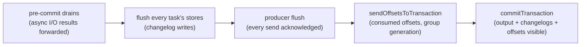
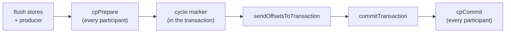

Exactly-once semantics (EOS) on Kafka itself is well understood: a
transactional producer whose transaction carries the output records,
the state stores' changelog writes and the consumed offsets. You
enable it with `processingGuarantee = ExactlyOnceV2`.

This only covers writes to Kafka topics. Writes to Postgres, S3,
Iceberg or HTTP endpoints need a two-phase-commit protocol on top:
a `TwoPhaseSink` registered as a commit participant prepares with
every commit and commits once Kafka has.

:::tip[Unfamiliar terms?]
Kafka, Streams, and Riffle terminology is defined in the [Glossary](../glossary/).
:::

:::note[TL;DR]

- Under `ExactlyOnceV2` each instance runs one transactional producer
  (`transactional.id = <application.id>-<random uuid>`), initialised
  once at start; consumers and restore readers read `read_committed`.
- Every commit interval (default **100 ms** under EOS, 30 s at least
  once; `commitIntervalMs = Nothing` picks it) is one transaction:
  output records, changelog writes, and the consumed offsets via
  `sendOffsetsToTransaction`, fenced by the group generation (KIP-447).
- An aborted transaction rewinds every task: closed dirty, its state
  directory wiped, restored from the changelogs up to the last stable
  offset, its partitions repositioned at the last committed offsets.
  Losing a partition (fenced out of the group) aborts the shared
  transaction, so the tasks that are kept are rewound too.
- After an unclean stop, the next start wipes
  `<state.dir>/<application.id>` and restores from the changelogs.
- Async I/O operators drain into the same transaction (the pre-commit
  drain hook).
- External systems take part through `CommitParticipant`s
  (`Kafka.Streams.Runtime.Commit`; `twoPhaseParticipant` builds one
  from a `TwoPhaseSink`): prepared after the flush, recorded as
  committed in `<application.id>-twophase-commits` inside the
  transaction, committed after it; prepared cycles left by a crash
  are settled at the next start.

:::

## The commit

The runtime's commit lives in `Kafka.Streams.Runtime.Tasks.tmCommit`.
It runs on the stream thread every commit interval, when a processor
asks (`ctxRequestCommit`), right before every rebalance (the
consumer's pre-rejoin hook, while the old generation can still
commit) and at close:



The transaction is opened lazily by the first send of the interval,
so an idle instance commits nothing. Under at least once the same
steps run without a transaction: the producer is flushed, failed sends
go to the production-exception handler, and the offsets are committed
with an explicit `OffsetCommit`.

| Failure | Outcome | Recovery |
| ------- | ------- | -------- |
| A send fails, the flush fails, `sendOffsetsToTransaction` is fenced (`ILLEGAL_GENERATION`), or `commitTransaction` fails | `CommitAborted` | The transaction is aborted (or, if the abort itself fails, the producer is re-initialised, which aborts it on the broker) and every task is recovered (below) |
| At least once: the offset commit fails (typically a rebalance) | `CommitFailed` | Nothing is lost: the records are processed again by whoever owns the partition next |
| A store can't flush, or (at least once) the production handler says fail | thrown | The stream thread stops; the uncaught-exception handler decides (`replaceThreadOnException`, the default, recovers every task and carries on) |

### Recovering a task

`tmRecoverAll` is what makes an abort harmless. Every task is closed
without a checkpoint, its directory under
`<state.dir>/<application.id>` is deleted, and it is rebuilt in the
restoring state: its source partitions are paused and repositioned at
the last committed offsets, and every logged store is replayed from
its changelog by a `read_committed` reader up to the last stable
offset, so the aborted writes never come back. When the restore is
done the partitions resume and the records after the last commit are
processed again, this time into a new transaction.

### Unclean stops

Local state is only trustworthy under EOS if the process stopped at a
commit boundary. A clean close (`closeKafkaStreams` that reached the
loop's final commit) leaves a marker file in
`<state.dir>/<application.id>`; the next start consumes it. A start
that finds no marker wipes the directory and restores everything from
the changelogs (`Kafka.Streams.Runtime.StateDir.prepareStateDir`).
At least once never wipes.

### Fencing

The transactional id is fresh per process, so producers are not
fenced by id (EOS v2). A zombie instance is fenced by the group
instead: its `sendOffsetsToTransaction` carries its member id and
generation, which the coordinator rejects once the group has moved on,
and the abort follows.

## Two-phase commit sinks

### Commit participants

A `CommitParticipant` (`Kafka.Streams.Runtime.Commit`) is an external
system that commits and aborts with the runtime's commits. Register
it with `addCommitParticipant` before starting. Each commit with
participants is a **cycle** with an id `<instance>/<n>` (`n`
increasing per run of an instance). Under exactly-once:



The marker is a record (key: instance, value: `n`) in the compacted
`<application.id>-twophase-commits` topic. It is part of the Kafka
transaction, so it exists exactly when the transaction committed.
Under at least once the order is prepare, marker (flushed), commit,
then the offset commit: a crash in between replays input, which
produces duplicates, never loss.

| Failure | Outcome |
| ------- | ------- |
| A participant's prepare fails | The participants that already prepared abort the cycle; the transaction aborts and every task is recovered |
| The marker, the offsets or `commitTransaction` fail | Every participant aborts the cycle; the transaction aborts and every task is recovered |
| A participant's commit fails (Kafka already committed) | The stream thread stops and the uncaught-exception handler decides; the cycle is committed by the recovery at the next start |

At start, before any task runs, the runtime reads the topic (the last
committed cycle of each instance) and settles every cycle a
participant still holds prepared (`cpRecover`): at or below its
instance's last committed cycle, it is committed; above it, aborted.
An id the runtime can't parse is logged and left alone.

### The `TwoPhaseSink` contract

`Kafka.Streams.Sinks.TwoPhase` defines the sink side as the
`TwoPhaseSink r` record:

```haskell
data TwoPhaseSink r = TwoPhaseSink
  { tpsName    :: !Text
  , tpsStage   :: !(r -> IO ())
  , tpsPrepare :: !(SinkTxnId -> [r] -> IO SinkOutcome)
  , tpsCommit  :: !(SinkTxnId -> IO SinkOutcome)
  , tpsAbort   :: !(SinkTxnId -> IO SinkOutcome)
  , tpsDiscardStaged :: !(IO ())
  , tpsRecover :: !(IO [SinkTxnId])
  }
```

`twoPhaseParticipant` turns one into a `CommitParticipant`, with the
cycle id as the `SinkTxnId`:

| Operation | When it runs | Sink must |
| --------- | ------------ | --------- |
| `tpsStage` | Per record, from the topology's `sinkTwoPhase` node | Buffer or speculatively write; **never** make visible |
| `tpsPrepare` | Once per cycle, after the flush (with no extra rows: everything arrives through `tpsStage`) | Make what was staged since the last cycle durable under the cycle id, but invisible |
| `tpsCommit` | Once per cycle, after Kafka committed it; again at recovery | Atomically make the prepared batch visible |
| `tpsAbort` | On any abort path; at recovery | Discard the prepared batch |
| `tpsDiscardStaged` | Whenever the runtime rewinds to the last commit (an aborted cycle, a replaced stream thread, under EOS a lost partition) | Drop everything staged since the last `tpsPrepare`: those records are processed, and staged, again |
| `tpsRecover` | Once at start | Return every `SinkTxnId` prepared on the external system and neither committed nor aborted |

`SinkOutcome` has three constructors:

- `SinkOK`: proceed.
- `SinkRetryable Text` or `SinkFatal Text` from `tpsPrepare`: the
  cycle aborts and the tasks rewind, so the input is processed (and
  staged) again into the next cycle.
- Either failure from `tpsCommit`: the stream thread stops, as above.

Every operation must be **[idempotent](../glossary/#idempotent--idempotency)**:
a crash and the recovery can replay any of them. The reference sinks
treat "this txn is already done" as `SinkOK`.

### Wiring

```haskell
import qualified Kafka.Streams.Sinks.TwoPhase as TPS
import qualified Kafka.Streams.Topology as Topo
import qualified Kafka.Streams.Topology.Free as F
import qualified Kafka.Streams.Runtime as R

main :: IO ()
main = do
  sink <- TPS.filesystemTwoPhaseSink "/var/lib/my-app/out" encodeRecord "orders-out"
  raw  <- F.buildTopologyFrom (source >>> F.sinkTwoPhase sink)
  topo <- either (fail . show) pure (Topo.validateTopology raw)
  ks <- R.newKafkaStreams cfg topo
  R.addCommitParticipant ks (TPS.twoPhaseParticipant sink)
  R.startKafkaStreams ks
```

Register the participant before `startKafkaStreams`: recovery runs at
start. Keep the sink's prepared state somewhere that survives the
process (the filesystem sink's directory, a database table), or a
crash between `commitTransaction` and `tpsCommit` loses the batch.

### Why prepare-then-commit is atomic

1. `tpsPrepare` writes the batch to the external system in a state no
   downstream reader sees. The reference `filesystemTwoPhaseSink`
   writes `prepared/<txn>.batch`; a JDBC adapter would write rows
   tagged pending; an Iceberg adapter would write data files without
   committing the manifest.
2. Kafka commits: the output, the changelogs, the offsets and the
   cycle marker become visible together.
3. `tpsCommit` flips the batch visible atomically (the filesystem sink
   renames `prepared/<txn>.batch` to `committed/<txn>.batch`, atomic on
   POSIX).

A crash between (2) and (3) leaves the batch prepared; the marker says
the cycle committed, so the recovery commits it. A crash before (2)
leaves no marker, so the recovery aborts it, and the input is
processed again from the last committed offsets.

## The four reference sinks

Each ships in `Kafka.Streams.Sinks.TwoPhase` so the chaos suite
can drive them deterministically. They illustrate the four
canonical 2PC patterns:

### `inMemoryTwoPhaseSink`

Pure-IO sink that buffers prepared batches in an `IORef Map`.
`tpsCommit` atomically promotes a prepared batch to the committed
history. Used by property tests to assert invariants like "every
committed row corresponds to a prepared txn that returned `SinkOK`".

### `filesystemTwoPhaseSink`

Writes each prepared batch to `<root>/prepared/<txn>.batch`,
renames to `<root>/committed/<txn>.batch` on commit. The rename is
atomic on POSIX, so a crash leaves the system in either
"prepared" or "committed" state but never both. This is the same
protocol Iceberg uses at the manifest layer and S3 uses at the
object-naming layer.

### `httpEchoTwoPhaseSink`

Buffers in memory; `tpsCommit` fires a caller-supplied `onCommit`
callback with the full batch. This is the shape a 2PC HTTP sink
takes when the upstream endpoint supports prepare/commit
endpoints (e.g. `POST /prepare/{txn}` then `POST /commit/{txn}`).

### Production adapters

There are no production adapters in the repository yet; a JDBC,
Iceberg, S3 or HTTP sink would live in its own package because each
pulls in its own driver. The shape each would take:

| Adapter | Prepare | Commit | Abort | Recover |
| ------- | ------- | ------ | ----- | ------- |
| JDBC | `INSERT` rows with `txn_id` column set | `UPDATE rows SET pending = false WHERE txn_id = ?` | `DELETE FROM rows WHERE txn_id = ?` | `SELECT DISTINCT txn_id FROM rows WHERE pending` |
| Iceberg | Write data files; defer manifest | Commit manifest pointing at data files | Delete the orphan data files | List pending data files not referenced by any manifest |
| S3 | Upload objects under `__pending__/<txn>/` | Rename / copy objects out of `__pending__/` | Delete `__pending__/<txn>/` | List `__pending__/` prefixes |
| HTTP | `POST /prepare/{txn}` with body | `POST /commit/{txn}` | `POST /abort/{txn}` | `GET /pending` returning prepared txn ids |

## Choosing the cadence

Under EOS, `commitIntervalMs` bounds both end-to-end latency (output
becomes visible to `read_committed` readers only at a commit) and how
much work an abort throws away. The default under EOS is 100 ms, the
JVM's.

| `commitIntervalMs` | Behaviour |
| ------------------ | --------- |
| `Nothing` (default) | 100 ms under EOS, 30 s at least once |
| `Just 1_000` | Fewer, larger transactions; output visible about a second late |
| `Just 30_000` | Long transactions: an abort replays up to 30 s of input, and readers wait as long |

## Common pitfalls

### Non-idempotent commit

If `tpsCommit` is not idempotent, a retry after a transient network
fault double-applies the batch. The contract is explicit: every
operation may be re-invoked. The reference sinks all encode
"already committed = no-op" by checking the prepared map / file
existence first.

### Forgetting to recover on startup

`tpsRecover` returning `[]` on every start is a sign you're not
actually checking the external system. A correct implementation
lists everything currently in the prepared state on the downstream;
the runtime commits or aborts each one.

### Side effects in `peek` / `foreach` under EOS

`peekStream`, `foreachStream`, `mapValuesM`, `mapKeyValueM`, and
`Punctuator` are **not** inside the producer transaction. Under
EOS-V2 the producer side is transactional and offsets commit
through `sendOffsetsToTransaction`, but these external effects
fire as the user code runs. A topology rewind on rebalance will
replay them.

If you need exactly-once for the side effect, you have three
choices, in order of strength:

1. **Two-phase commit sink.** `tpsStage` per record, prepare /
   commit per cycle. Strongest, most code.
2. **Idempotency token in a state store.** Compute a stable
   token per record (e.g. the upstream Kafka `(topic, partition,
   offset)` tuple), check the store inside the processor before
   firing the side effect, write the token to the store after.
   The store write reaches its changelog inside the same
   transaction as the offsets, and an abort restores the store from
   the changelog, so the token and the offsets agree. On a replay, the
   processor sees the token and skips. Same pattern the JVM
   docs recommend.
3. **Best-effort + reconciliation.** Accept that the side effect
   replays on rewind; design downstream to deduplicate. Lowest
   cost; weakest guarantee.

### Stores without a changelog

A store with logging disabled (`withLoggingDisabled`) can't be
restored, so after an abort or an unclean stop it starts empty. Under
EOS keep logging on for every store whose contents matter.

### A sink that fails to commit

When `tpsCommit` fails after Kafka committed, the stream thread stops
(and, with the default `replaceThreadOnException`, carries on); the
batch stays prepared until the recovery at the **next start** commits
it. Until then it is invisible downstream. If the sink's `tpsRecover`
is correct, the only operator action needed is a restart; if it's
buggy, you may have a permanently half-committed sink that needs
manual fixing. Alert on `commit <sink> for <cycle>` failures in the
log.

## Verifying EOS in tests

`Kafka.Streams.Runtime.MockBroker` is an in-memory cluster with
transactions, `read_committed` visibility and fault injection, so the
real runtime can be driven through an abort:

1. `newMockBroker`, `mockCreateTopic` the inputs, start the topology
   with `startKafkaStreamsWith ks =<< mockDriverFor broker cfg` and
   `processingGuarantee = ExactlyOnceV2`.
2. `mockProduce` input; once some output is committed,
   `mockFailTransactionCommits broker n` (or `mockFailSends`) to make
   the next commits fail.
3. Assert on `mockVisibleRecords` (what a `read_committed` reader
   sees): every key's output appears exactly once, nothing from the
   aborted transactions; `mockRecords` still shows the aborted writes.

`Streams.TaskRuntimeSpec` ("exactly-once: an aborted transaction leaves
no trace in committed output") is the template. The sink contract on
its own is covered by `Streams.Properties.TwoPhaseSinkSpec`
(`runSinkCommitCycle` drives one cycle without the runtime).

## Related reading

- [Enrichment via external systems](../guides/enrichment/) -
  if the external system is read-only and you just want to look up
  data, async I/O is usually simpler than 2PC.
- [Visibility versus ACID databases](./visibility/): how
  "exactly once into Kafka" differs from "atomic commit in
  Postgres".
- [Runbooks](./runbooks/): what to do when commits abort.
