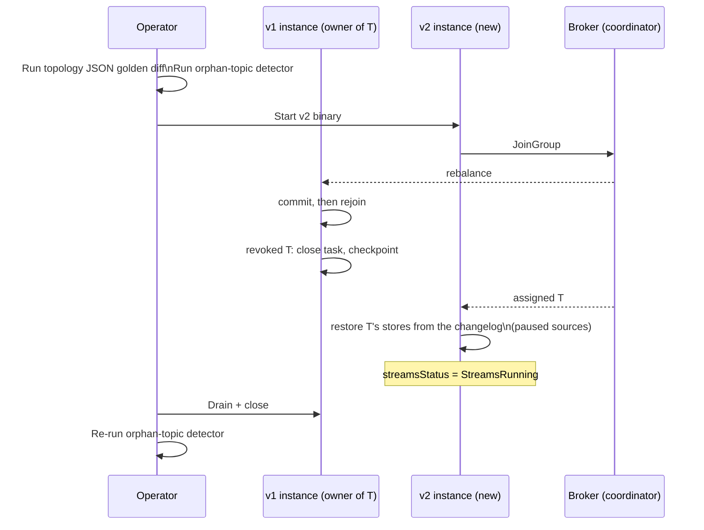

Deploying a new version of your Kafka Streams application requires care. Unlike stateless services where you can simply restart with new code, streaming applications have persistent state and internal topics that must be managed across versions.

:::tip[Unfamiliar terms?]
Kafka, Streams, and Riffle terminology is defined in the [Glossary](../glossary/).
:::

:::note[TL;DR]

- Five kinds of topology diff each have a different operational story; the table below classifies them.
- Name every stateful operator explicitly (`Named` + `materializedAs`): auto-generated names shift when you reshuffle the topology, which renames their changelog topics.
- Run the [topology-JSON golden-file diff](../observability/#topology-json) in CI and the [orphan-topic detector](../observability/#orphan-topic-detection) on startup.
- There are no standby replicas: a task that moves restores its stores from the changelogs before processing. Keep that short with persistent stores on stable volumes and compacted changelogs.
- Each member commits before it rejoins, closes revoked tasks before the new owner builds them, and the new owner restores first: no double processing within a generation.

:::

## What a "topology change" actually means

There is no single answer to "did my topology change". There are five
overlapping diffs, and each one has a different operational story.

| Diff | Example | Stops processing? | Loses state? | Leaks topics? |
| ---- | ------- | ----------------- | ------------ | ------------- |
| Inserted a `peek` or `foreach` | Adding a log line | No | No | No |
| Renamed an internal node | Removed a `Named` annotation | No | **Sometimes** | **Yes** |
| Added a new operator with a new store | New `count` aggregation | No (new store starts empty) | No | No |
| Removed an operator with a store | Deleted a `groupBy`+`count` | No | The removed store's data is gone; its changelog becomes an orphan | **Yes** |
| Changed the key, value, or window of an existing store | Switched `Materialized` value serde | **Yes (must migrate)** | **Yes if you don't migrate** | Possibly |

The rest of this page expands each row.

## Stable names are the deployment contract

Every operator in your topology gets a name. `Kafka.Streams.Topology.StableNames`
(KIP-307) generates that name deterministically based on (a) the
operator class and (b) the order in which operators were added to the
builder. A generated name looks like `KSTREAM-MAPVALUES-0000000007`.

The framework derives **internal topic names** from operator names
and the `applicationId`. The convention is:

- Changelog: `<applicationId>-<storeName>-changelog`
- Repartition: `<applicationId>-<nodeName>-repartition`

See `Kafka.Streams.Observability.OrphanTopics.changelogTopic` and
`Kafka.Streams.Observability.OrphanTopics.repartitionTopic` for the
exact derivation.

**If the name changes, the broker creates a new internal topic and
abandons the old one.** The old changelog topic doesn't disappear; it
sits on the broker and silently consumes disk forever, while the new
store starts from empty and warms via the new changelog.

Two real-world ways to accidentally change names:

1. **Inserting an operator earlier in the chain.** Because the
   generator's counter is per-`OperatorClass`-and-per-topology, adding
   a `MapValues` upstream of an existing one renumbers every
   subsequent `MapValues`. If any of those downstream nodes own a
   store with logging enabled, you just renamed its changelog.
2. **Removing or changing a `Named`.** Explicit `Named "my-aggregator"`
   pins the name across builds. Removing it lets the auto-generator
   take over and pick a different number.

### How to defend against name drift

**Rule one: name everything that owns state.** Every operator that
produces a stateful store should pass an explicit `Named` value with
a stable, version-independent string. Same for any `repartition` /
`through` operator (those create repartition topics). Anything else
can stay auto-generated; you may rename a `mapValues` freely.

**Rule two: use the orphan-topic detector in CI and on startup.**
`Kafka.Streams.Observability.OrphanTopics.detectOrphans` is a pure
function:

```haskell
detectOrphans
  :: Topology
  -> Text              -- applicationId
  -> [TopicName]       -- topics the broker reports
  -> [OrphanInternalTopic]
```

In CI, compare against the previous topology's expected set
(`expectedInternalTopics` returns it). On startup, hand the runtime
an `AdminClient.listTopics` result and log any orphans:

```haskell
expected <- pure (expectedInternalTopics topo appId)
broker   <- AdminClient.listTopics admin
forM_ (detectOrphans topo appId broker) $ \o ->
  warn ("orphan internal topic: " <> unTopicName (orphanTopic o))
```

The detector does **not** delete anything. Auto-deletion of orphans
is a foot-gun: a misconfigured rollout (wrong `applicationId`, two
overlapping deploys) would happily nuke live state. Make it a manual,
audited operator action.

**Rule three: run a topology-shape diff in CI.** The
`Kafka.Streams.Observability.Topology.topologyDescription` function
emits a versioned JSON document. Snapshot it into your repo as a
golden file. Any PR that changes the topology will surface the diff
explicitly:

```haskell
import qualified Data.Aeson.Encode.Pretty as P
import qualified Kafka.Streams.Observability.Topology as Obs

main :: IO ()
main = do
  topo <- buildTopologyFrom topology
  BL.writeFile "topology.golden.json"
    (P.encodePretty (Obs.topologyDescription topo))
```

A diff that touches `sources`, `stores`, or `edges` is a deploy you
have to think about. A diff that only touches `processors` (renumbered
unnamed nodes) is harmless **only if** none of the renumbered nodes
own state.

## The five diff types in detail

### 1. Inserting a pure stateless operator

Adding `peek`, `foreach`, `mapValues`, `filter`, etc. in the middle of
a chain: provided neither the operator nor anything downstream of it
owns state: is the easiest case. The framework will renumber the
following auto-generated names, but no internal topic depends on them.
Roll out normally.

### 2. Renaming an internal node

If the renamed node owns a store with `loggingEnabled` (the default
for `count`, `reduce`, `aggregate`, and most `Materialized` builders),
the changelog topic name moves. Procedure:

1. **Don't do this casually.** Pin the name with `Named` on the
   first version and avoid renaming.
2. If you must rename, deploy in two stages:
   - Stage 1: keep the old node + name; add the new node with a new
     name and a `peek`/`foreach` that copies records to the new
     pipeline. Both nodes write to their respective changelogs.
   - Stage 2: once you're satisfied the new node has warmed and
     matches the old, remove the old one. The old changelog is now
     an orphan; resolve it via the orphan-topic procedure.

This is the same migration pattern as a database column rename:
double-write, verify, cut over, decommission the old column.

### 3. Adding a new operator with a new store

Roll out normally. The runtime creates the new store's changelog at
startup; the store starts empty (its changelog is new) and fills as
records arrive.

The interesting case is when the new store needs to be **populated
from scratch on rollout** (e.g. you added a new `aggregate` whose
input is a topic that has been live for months). The store will
replay the input from `earliest` or `latest` depending on the
`Consumed.AutoOffsetReset` of the source. Plan for the warmup
period; new queries against the store will see partial state until
warmup completes.

### 4. Removing an operator with a store

The store's local files are removable; `cleanUp` (the Haskell port of
`KafkaStreams.cleanUp()`) wipes them on next start. The changelog
topic on the broker is **not** removable by the runtime: it lives
on. Treat it as an orphan and resolve via the procedure in
[Observability](../observability/#orphan-topic-detection).

### 5. Changing the key, value, or window of an existing store

This is a **breaking change**. The existing changelog encodes records
under the old serde / window definition; the new code can't read
them. Three options:

| Strategy | When to use |
| -------- | ----------- |
| **Schema evolution within the same serde** (e.g. add an optional Avro field) | Both versions can still deserialize each other |
| **`SchemaVersioned` store** | You want the runtime to migrate reads forward and (optionally) burn-in writes |
| **Rename + double-write** | Schema is irreconcilable; treat as case (2) |

For the second option, `Kafka.Streams.State.KeyValue.SchemaVersioned`
wraps any `KeyValueStore` and tags every write with the current
`SchemaVersion`. Reads of older versions are migrated through a
`SchemaMigration` chain you supply. `burnInMigrate` rewrites older
entries onto the current version with resumable `BurnInProgress`. The
canonical use is "v3 of my topology reads what v1 wrote and is happy
about it".

## The consumer-group side of a rolling deploy

The runtime joins a Kafka consumer group keyed on `applicationId`,
with the classic group protocol and the range assignor. Each new
instance is a new group member. The rules:

- **Before rejoining**, every member commits what its tasks have
  processed (the consumer's pre-rejoin hook, while the old generation
  can still commit). A member that fell out of the group (lost
  partitions) commits nothing; under exactly-once its open
  transaction is fenced by the generation and aborted.
- **Revoked** partitions' tasks are closed cleanly and checkpointed;
  **assigned** partitions' tasks are built with their sources paused
  while every logged store restores from its changelog, then resume
  from the committed offsets.
- **Probing rebalances** (`Kafka.Streams.Runtime.ProbingRebalance`)
  fire every `probingRebalanceIntervalMs` (default 10 minutes) when a
  warmup reported through `reportWarmupLag` is within
  `acceptableRecoveryLag`. Nothing reports warmups on its own, since
  there are no standby replicas.

### Restore time is the difference between a tolerable deploy and a bad one

Each task's state lives on exactly one instance, plus its changelog.
When that instance drains, the next instance to inherit the task
restores from its checkpoint, if it has one for that task (it owned
the task before, on the same volume), else the **entire** changelog,
before processing. For a 1 TB store at 100 MB/s, that is ~3 hours of
blackhole on any query against that task.

To keep it short:

- Use persistent stores (`persistentKeyValueStoreBuilder`) on a
  persistent volume, with a stable `clientId` per instance so a
  restarted instance gets its own partitions back (see
  [Running in containers](./containers/#2-stable-identity-across-restarts)).
- Keep changelogs compacted (the runtime creates them with
  `cleanup.policy=compact`).
- Spread big state over more partitions: restore is per task.

### Suggested rollout shape

For a topology that owns meaningful state, the rolling deploy
unfolds along this timeline:



Concrete steps:

1. **Pre-flight (on the operator's machine):**
   - Build v2 locally.
   - Run the topology-shape golden-diff test.
   - Run the orphan-topic detector against the live broker (using
     read-only AdminClient credentials).
   - If either reports drift you didn't intend, fix the diff before
     deploying.
2. **Deploy v2 to one instance.**
3. **Wait for the new instance to reach `StreamsRunning`**
   (`streamsStatus`). That is bounded by its tasks' restore time.
4. **Confirm assignment.** `ownedPartitions` (or
   `metadataForLocalThreads`) reports owned partitions; verify the
   rebalance went where you expected.
5. **Roll the rest of the fleet** one instance at a time, waiting
   for `StreamsRunning` between each. If you batch the rollout, many
   tasks restore at once and the whole application stalls for the
   longest restore.
6. **Post-rollout, re-run the orphan detector and clean up any
   leaked internal topics** via a manual broker AdminClient delete.

## Multi-instance with no state

If your topology owns no state (it is pure `map` / `filter` / `merge`
/ sinks), the only deploy concern is normal Kafka consumer-group
behaviour: a brief pause while the group reconciles, no replay, no
warmup. You can roll as aggressively as the broker tolerates.

## Cleaning up local state on the instance

`Kafka.Streams.Runtime.cleanUp` wipes `<state.dir>/<application.id>`
(only while the instance isn't running) and every task restores from
its changelog on the next start. Use it when:

- A node was offline long enough that incremental warmup is slower
  than a fresh fetch.
- You suspect local store corruption.
- You're decommissioning the instance and don't want stray state
  on disk.

`cleanUp` does **not** touch broker-side topics. The runtime owns the
local directory; the broker owns the changelog. Auto-deletion of
broker topics on `cleanUp` would be a foot-gun for the same reasons
as auto-deleting orphans.

## Multi-version coexistence during the rollout window

For the duration of a rolling deploy you have v1 and v2 instances in
the same consumer group. Three things to be aware of:

1. **Assignor compatibility.** Every member must use the same
   assignment strategy. The runtime's consumer always uses the range
   assignor, so this only bites if a `consumerOverrides` changes
   `consumerAssignmentStrategy` on some instances and not others.
2. **Operator shape drift.** If v1 expects record value `{a, b}` and
   v2 produces `{a, b, c}`, every v1-owned task that consumes those
   records must tolerate the extra field. This is the standard
   schema-evolution discipline: backwards-and-forwards compatibility
   on the wire serdes, especially when you're using Schema Registry.
3. **[Processing-guarantee](../glossary/#processing-guarantee) mismatch.** Switching `processingGuarantee`
   between `AtLeastOnceP` and `ExactlyOnceV2` mid-rollout is **not**
   safe. Drain v1 first, then bring up v2 with the new guarantee.
   Otherwise v1 instances are committing offsets outside the
   transactional cycle and v2 instances inside it; the consumer group
   will see inconsistent commit semantics.

## What to put in your release checklist

- [ ] Topology JSON golden-diff has been reviewed.
- [ ] Orphan-topic detector reports nothing unexpected against the
      live broker.
- [ ] Restore time per task is acceptable (persistent stores on
      stable volumes, or you have explicitly accepted the cold-start
      penalty for this rollout).
- [ ] `applicationId` is unchanged. (Changing it is a fresh-start
      deploy, not a rollout. Be sure you mean it.)
- [ ] `processingGuarantee` is unchanged.
- [ ] If you renamed a stateful operator, you have a corresponding
      cleanup plan for the old changelog.
- [ ] If you changed a store's serde, you either use
      `SchemaVersioned` or you've performed a double-write migration.

## Related reading

- [Scaling and rebalancing](./scaling/): what changes when you also
  change instance count.
- [Observability](./observability/): how to see what the rolling
  deploy is doing in real time.
- [Runbooks](./runbooks/): the failure modes this page describes,
  paired with response procedures.
