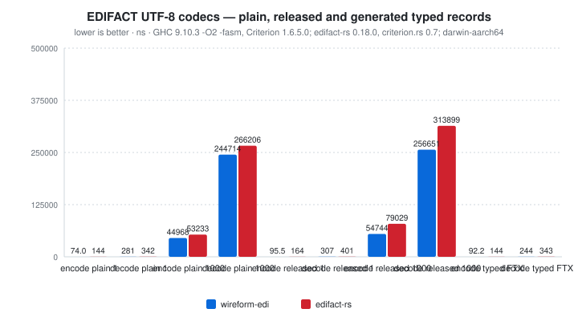

# wireform-edi

[](https://opensource.org/licenses/BSD-3-Clause)

> [!CAUTION]
> wireform is in heavy development and has not been published to Hackage yet. APIs may change.

Electronic Data Interchange (EDI) segment tooling for Haskell. The package
models delimiter syntax explicitly, parses ordered segments into a dynamic ADT,
infers X12 delimiters from `ISA` headers, understands UN/EDIFACT `UNA`
service strings, validates envelopes and control numbers, generates accepted
997 acknowledgements, and exposes annotation-driven Template Haskell deriving
for typed segment records.

This package is part of the [wireform](https://github.com/iand675/wireform-)
monorepo and shares its annotation deriver and testing discipline with every
other format package.

## Install

```cabal
build-depends:
  base,
  wireform-edi,
  wireform-derive,    -- only if you want the annotation deriver
```

Clone the repo and run `cabal build wireform-edi` to compile locally.

## Hello world

```haskell
{-# LANGUAGE OverloadedStrings #-}

import qualified Data.Vector as V
import qualified EDI.Decode as D
import qualified EDI.Encode as E
import EDI.Value

doc :: Interchange
doc = Interchange defaultSyntax
  (V.fromList
    [ Segment "ST"  (V.fromList [Simple "850", Simple "0001"])
    , Segment "BEG" (V.fromList [Simple "00", Simple "SA", Simple "12345"])
    ])

main :: IO ()
main = do
  print (E.encode doc)
  print (D.decode "ST*850*0001~BEG*00*SA*12345~")
```

`EDI.Derive` maps Haskell records to single positional segments:

```haskell
{-# LANGUAGE TemplateHaskell #-}

import Data.Text (Text)
import EDI.Class
import EDI.Derive
import Wireform.Derive

data NameSegment = NameSegment
  { entityCode :: !Text
  , nameValue  :: !Text
  }

{-# ANN NameSegment (forBackend backendEDI (rename "N1")) #-}
deriveEDI ''NameSegment
```

## What's in here

| Module | Role |
|--------|------|
| `EDI.Value` | `Syntax`, `Interchange`, `Segment`, and `Element` ADTs |
| `EDI.Encode` | Text and UTF-8 rendering |
| `EDI.Decode` | Parser with X12 `ISA` delimiter inference |
| `EDI.EDIFACT` | UN/EDIFACT `UNA` parsing, release-aware encoding/decoding, and UNB/UNH/UNT/UNZ validation |
| `EDI.Class` | `ToEDI` / `FromEDI` and field-level scalar classes |
| `EDI.Derive` | Template Haskell deriver for typed segment records |
| `EDI.Encoding` | Small builder wrapper used by encoders |
| `EDI.Query` | Segment lookup, element access, and tag counting helpers |
| `EDI.Standard` | Profiles and detection for UN/EDIFACT, X12, GS1 EDI, TRADACOMS, ODETTE, VDA, HL7, HIPAA, IATA Cargo-IMP, NCPDP SCRIPT, NCPDP Telecom, and EDIGAS |
| `EDI.Validation` | Generic delimiter-safety and structural validation |
| `EDI.X12` | X12 envelope grouping, control validation, and 997 acknowledgements |

`EDI.Standard` covers standards that are not all the same physical syntax.
Delimiter-separated families get a `Syntax`; XML-oriented families like NCPDP
SCRIPT and fixed-width families like VDA are registered and detectable, but
their payload-specific parsers belong in dedicated modules before the dynamic
`Segment` ADT can represent them losslessly.

For EDIFACT, use `EDI.EDIFACT.encodeEDIFACT advice doc` (or
`encodeEDIFACTBS`) so literal service characters are released correctly.
The advice must match the document syntax; custom advice is written as UNA.
`EDI.Encode` is the literal delimiter renderer used by X12 and generic
segments. It does not infer a release character from the syntax alone.
A single-component composite has the same wire form as a simple element;
use at least two components when that distinction must survive decoding.

## Testing

```bash
cabal test wireform-edi:wireform-edi-derive-test
cabal test wireform-test --test-show-details=streaming
```

The tests cover dynamic segment parsing, standard-family detection, EDIFACT
release-character decoding, X12 delimiter inference, envelope validation, 997
generation, encode/decode round-trips, and TH-derived segment codecs.

## License

BSD-3-Clause.


## Benchmarks

Run the paired benchmarks sequentially with
`python3 scripts/run-benchmarks.py --only edi`. See
[`interop/edifact-rs`](../interop/edifact-rs/README.md) for the pinned Rust
reference, workload definitions and optional interoperability checks.

The UTF-8 encoder uses `wireform-core`'s growing buffer, starting with a
64-byte estimate per segment (128-byte minimum, 64 KiB initial cap). It
grows when needed rather than scanning every field to size the document.
The default service alphabet uses bounded word copies; custom advice uses
the same release rules with scalar copying. The decoder scans segment
boundaries once and materializes fields directly into vectors.

<!-- BEGIN_AUTOGEN bench:edi-rust-codec -->
<picture>
  <source media="(prefers-color-scheme: dark)" srcset="bench-results/charts/edi-rust-codec-dark.svg">
  
</picture>

| Operation            | wireform-edi | edifact-rs | ratio |
| :------------------- | -----------: | ---------: | ----: |
| encode plain 1       |      74.0 ns |     144 ns | 0.51x |
| decode plain 1       |       281 ns |     342 ns | 0.82x |
| encode plain 1000    |     44968 ns |   53233 ns | 0.84x |
| decode plain 1000    |    244714 ns |  266206 ns | 0.92x |
| encode released 1    |      95.5 ns |     164 ns | 0.58x |
| decode released 1    |       307 ns |     401 ns | 0.77x |
| encode released 1000 |     54744 ns |   79029 ns | 0.69x |
| decode released 1000 |    256651 ns |  313899 ns | 0.82x |
| encode typed FTX     |      92.2 ns |     144 ns | 0.64x |
| decode typed FTX     |       244 ns |     343 ns | 0.71x |

<sub>Last run 2026-11-04 13:29:28 UTC. GHC 9.10.3 -O2 -fasm, Criterion 1.6.5.0; edifact-rs 0.18.0, criterion.rs 0.7; darwin-aarch64.</sub>
<!-- END_AUTOGEN bench:edi-rust-codec -->
