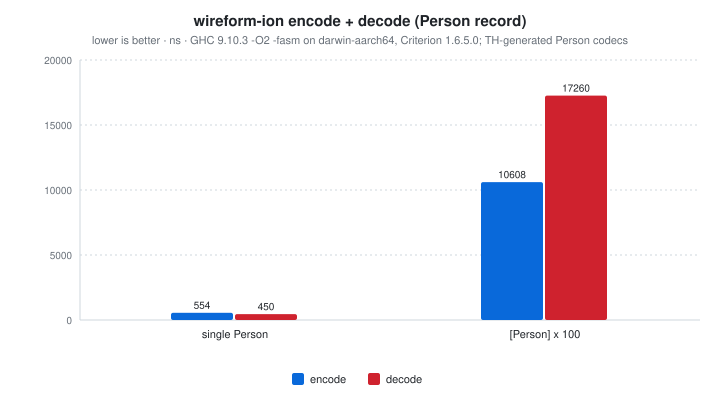
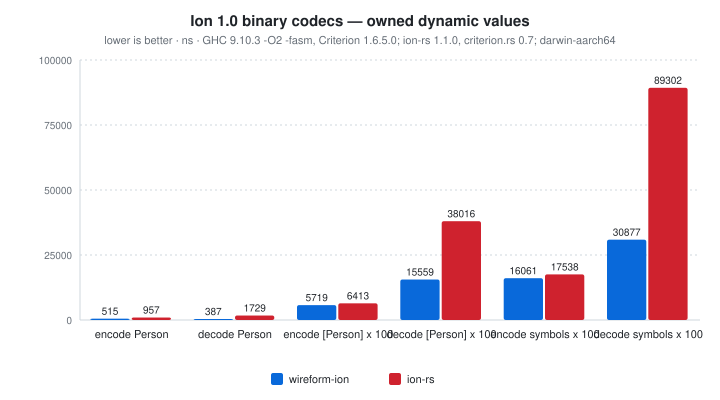
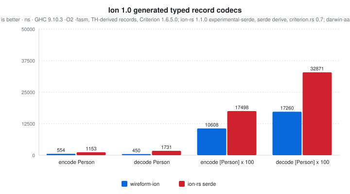

# wireform-ion

[](https://opensource.org/licenses/BSD-3-Clause)


> [!CAUTION]
> wireform is in heavy development and has not been published to Hackage yet. APIs may change.

[Amazon Ion](https://amazon-ion.github.io/ion-docs/) for Haskell. The
binary wire format, the dynamic [`Ion.Value`](src/Ion/Value.hs), the
annotation-driven Template Haskell deriver, the
[Ion Schema Language](https://amazon-ion.github.io/ion-schema/) (ISL)
parser and code generator, plus a `[isl| ... |]` quasiquoter for inline
schemas.

Ion is Amazon's open-source data format. The data model is a strict
superset of JSON: it adds timestamps with full timezone preservation,
arbitrary-precision decimals, symbols, blobs, clobs, S-expressions,
and value-level annotations. Two serializations exist (a text form
and a binary form) and round-trip 1:1; this package implements the
binary form. Ion is used internally at AWS for QLDB, AppSync, and a
number of other services, with official client libraries for Java,
Python, JavaScript, C, C++, Go, .NET, and Rust.

This package is part of the [wireform](https://github.com/iand675/wireform-)
monorepo and shares its allocation primitives, annotation deriver, and
testing discipline with every other format.

## Install

```cabal
build-depends:
  base,
  wireform-ion,
  wireform-derive,    -- only if you want the cross-format annotation deriver
```

The package is part of the [wireform](https://github.com/iand675/wireform-)
monorepo. Clone the repo and `cabal build wireform-ion` to compile
locally. Compiling with the LLVM backend (`-fllvm`) adds compile time
but measurably improves runtime performance.

## Hello world

```haskell
{-# LANGUAGE DeriveAnyClass #-}
{-# LANGUAGE DerivingStrategies #-}

import GHC.Generics (Generic)
import Data.Text (Text)
import Ion.Class (ToIon, FromIon, encodeIon, decodeIon)

data Event = Event
  { eventType :: !Text
  , timestamp :: !Int
  , payload   :: !Text
  } deriving stock (Show, Eq, Generic)
    deriving anyclass (ToIon, FromIon)

main :: IO ()
main = do
  let evt   = Event "click" 1700000000 "button-submit"
      bytes = encodeIon evt
  case decodeIon bytes of
    Right (decoded :: Event) -> print decoded
    Left  err                -> putStrLn err
```

The runnable version lives in [`examples/IonExample.hs`](../examples/IonExample.hs).

## What's in here

| Module             | Role                                                      |
|--------------------|-----------------------------------------------------------|
| `Ion.Value`        | Dynamic `Value`: null, bool, Int64, Double, string, symbol, blob, clob, list, struct and annotations |
| `Ion.Encoding`     | The `Encoding` builder type used by `ToIon` instances     |
| `Ion.Encode`       | Ion 1.0 binary encoder with direct buffer writes and local symbol interning |
| `Ion.Decode`       | Bounded Ion 1.0 binary decoder with local symbol table resolution |
| `Ion.Class`        | Public `ToIon` / `FromIon` typeclasses + `encodeIon` / `decodeIon` |
| `Ion.Derive`       | `deriveIon` / `deriveToIon` / `deriveFromIon` Template Haskell entry points |
| `Ion.SchemaLang`   | ISL parser (`parseISL :: Text -> Either String ISLSchema`) |
| `Ion.ISLSchema`    | ISL AST types (`ISLSchema`, `ISLType`, `ISLConstraint`, `ISLImport`, ...) |
| `Ion.ISLCodeGen`   | Generate Haskell types and `ToIon` / `FromIon` instances from an ISL schema |
| `Ion.QQ`           | `[isl| ... |]` quasiquoter                                |

## Binary compatibility

Symbols, field names and annotations use Ion 1.0 symbol IDs. The encoder
emits a local symbol table before the user value when needed and reuses
system IDs. The decoder processes table replacement, append imports,
version-marker resets, duplicate/gap slots and padding. Ordered annotation
constructors are emitted as one binary wrapper.

The dynamic model is intentionally limited to the types listed above.
Decimal, timestamp, s-expression, typed-null and unknown-text symbol values
return `Left`; they are not silently converted into other values. There is
no shared-symbol catalog API yet. An unavailable import with `max_id`
reserves its SID range, so subsequent local symbols remain readable;
referencing its unknown text fails. An import without `max_id` fails because
its size cannot be resolved without a catalog. The single-value decoder
requires exactly one user value, apart from system tables, markers and NOPs.
Earlier implementations wrote symbol text where the binary format requires IDs;
those nonstandard symbol-bearing bytes are not a supported interchange format.

## Encode and decode

The typeclass entry points are the usual shape:

```haskell
encodeIon :: ToIon   a => a          -> ByteString
decodeIon :: FromIon a => ByteString -> Either String a
```

For dynamic values without a Haskell type to mirror them, work with
[`Ion.Value`](src/Ion/Value.hs) directly. The `Value` ADT carries
Ion-specific shapes such as annotations, symbols, blobs and clobs. Check
the supported-type list above before using it as an interchange model;
decimals and timestamps are not represented by this ADT.

## Annotation-driven deriving

`Ion.Derive` consumes the cross-format `Wireform.Derive.Modifier`
vocabulary from [`wireform-derive`](../wireform-derive/README.md), so
the same annotated record can produce Ion, JSON, and any other
backend's instances without redefining the field shapes:

```haskell
{-# LANGUAGE TemplateHaskell #-}

import qualified Ion.Derive            as DIon
import qualified Wireform.Derive.Aeson as DAeson
import Wireform.Derive (rename, renameStyle, SnakeCase, forBackend, backendJSON)

data Person = Person
  { personFullName :: !Text
  , personAge      :: !Word32
  } deriving stock (Show, Eq, Generic)

{-# ANN type Person ("Person" :: String) #-}
{-# ANN personFullName (renameStyle SnakeCase) #-}
{-# ANN personAge      (renameStyle SnakeCase) #-}
{-# ANN personFullName (forBackend backendJSON (rename "fullName")) #-}

DIon.deriveIon    ''Person
DAeson.deriveJSON ''Person
```

## ISL: schema and code generation

[Ion Schema Language](https://amazon-ion.github.io/ion-schema/) is the
schema dialect for Ion. wireform-ion parses it with
`Ion.SchemaLang.parseISL` and generates Haskell types + `ToIon` /
`FromIon` instances with `Ion.ISLCodeGen`:

```haskell
{-# LANGUAGE TemplateHaskell #-}
import Ion.QQ (isl)

[isl|
  type::{
    name: person,
    type: struct,
    fields: { name: string, age: int }
  }
|]
-- Generates: data Person = Person { name :: Text, age :: Int }
--            instance ToIon Person ; instance FromIon Person
```

For external `.isl` files, the `wireform-gen` CLI in the umbrella
package wraps the same codegen.

## Testing

The per-format Hedgehog suite lives in `test/`:

```bash
cabal test wireform-ion:wireform-ion-derive-test
```

It covers the typeclass instances, TH-derived round-trips, dynamic values,
independent binary fixtures, symbol-table transitions and malformed input.
Set `WIREFORM_ION_REFERENCE` as described in
[`interop/ion-rs`](../interop/ion-rs/README.md) to include the pinned official
Rust interoperability checks. This focused suite does not exercise the ISL
parser or its code generator.

## Benchmarks

A criterion harness in [`bench/Bench.hs`](bench/Bench.hs):

```bash
cabal bench wireform-ion:wireform-ion-bench
```

<!-- BEGIN_AUTOGEN bench:ion-encode-decode -->
<picture>
  <source media="(prefers-color-scheme: dark)" srcset="bench-results/charts/ion-encode-decode-dark.svg">
  
</picture>

| Operation      |   encode |   decode | ratio |
| :------------- | -------: | -------: | ----: |
| single Person  |   554 ns |   450 ns | 0.81x |
| [Person] x 100 | 10608 ns | 17260 ns | 1.63x |

<sub>Last run 2026-11-04 13:05:38 UTC. GHC 9.10.3 -O2 -fasm on darwin-aarch64, Criterion 1.6.5.0; TH-generated Person codecs.</sub>
<!-- END_AUTOGEN bench:ion-encode-decode -->

The manifest-driven Rust comparisons below separate owned dynamic values
from generated typed records. Run them sequentially using the commands in
[`interop/ion-rs`](../interop/ion-rs/README.md). Allocation regressions can be
captured with `--benchmark-options='--regress allocated:iters'`.

## License

BSD-3-Clause.

## References

- [Amazon Ion data model](https://amazon-ion.github.io/ion-docs/docs/spec.html)
- [Ion binary encoding](https://amazon-ion.github.io/ion-docs/docs/binary.html)
- [Ion Schema Language 2.0](https://amazon-ion.github.io/ion-schema/docs/isl-2-0/spec)


<!-- BEGIN_AUTOGEN bench:ion-rust-codec -->
<picture>
  <source media="(prefers-color-scheme: dark)" srcset="bench-results/charts/ion-rust-codec-dark.svg">
  
</picture>

| Operation             | wireform-ion |   ion-rs | ratio |
| :-------------------- | -----------: | -------: | ----: |
| encode Person         |       515 ns |   957 ns | 0.54x |
| decode Person         |       387 ns |  1729 ns | 0.22x |
| encode [Person] x 100 |      5719 ns |  6413 ns | 0.89x |
| decode [Person] x 100 |     15559 ns | 38016 ns | 0.41x |
| encode symbols x 100  |     16061 ns | 17538 ns | 0.92x |
| decode symbols x 100  |     30877 ns | 89302 ns | 0.35x |

<sub>Last run 2026-11-04 13:06:38 UTC. GHC 9.10.3 -O2 -fasm, Criterion 1.6.5.0; ion-rs 1.1.0, criterion.rs 0.7; darwin-aarch64.</sub>
<!-- END_AUTOGEN bench:ion-rust-codec -->

### Generated typed records

The typed Rust reference uses `ion-rs` 1.1.0's experimental serde bridge;
this is separate from the owned dynamic-value codec comparison. Fixture
construction is outside the clock on both sides.

<!-- BEGIN_AUTOGEN bench:ion-rust-typed -->
<picture>
  <source media="(prefers-color-scheme: dark)" srcset="bench-results/charts/ion-rust-typed-dark.svg">
  
</picture>

| Operation             | wireform-ion | ion-rs serde | ratio |
| :-------------------- | -----------: | -----------: | ----: |
| encode Person         |       554 ns |      1153 ns | 0.48x |
| decode Person         |       450 ns |      1731 ns | 0.26x |
| encode [Person] x 100 |     10608 ns |     17498 ns | 0.61x |
| decode [Person] x 100 |     17260 ns |     32871 ns | 0.53x |

<sub>Last run 2026-11-04 13:07:17 UTC. GHC 9.10.3 -O2 -fasm, TH-derived records, Criterion 1.6.5.0; ion-rs 1.1.0 experimental-serde, serde derive, criterion.rs 0.7; darwin-aarch64.</sub>
<!-- END_AUTOGEN bench:ion-rust-typed -->
